


 

  


  


<table>
  <tr>
    <td width="50%" valign="top">
      <a href="https://github.com/priyanshusharan-cmd/warden"></a>
    </td>
    <td width="50%" valign="top">
      <a href="https://github.com/priyanshusharan-cmd/celestia"></a>
    </td>
  </tr>
  <tr>
    <td width="50%" valign="top">
      <a href="https://ridify.onrender.com"></a>
    </td>
    <td width="50%" valign="top">
      
    </td>
  </tr>
</table>

<a href="https://github.com/priyanshusharan-cmd/warden">warden</a> &nbsp;·&nbsp;
<a href="https://celestia-website.onrender.com">celestia ↗ live</a> &nbsp;·&nbsp;
<a href="https://ridify.onrender.com">ridify ↗ live</a>

  



  


<picture>
  <source media="(prefers-color-scheme: dark)" srcset="https://raw.githubusercontent.com/priyanshusharan-cmd/priyanshusharan-cmd/output/snake-dark.svg"/>
  <source media="(prefers-color-scheme: light)" srcset="https://raw.githubusercontent.com/priyanshusharan-cmd/priyanshusharan-cmd/output/snake-light.svg"/>
  
</picture>

  


  Open to <b>internships</b>, <b>hackathon teams</b> and <b>freelance builds</b>. 
  The fastest way to reach me is LinkedIn.

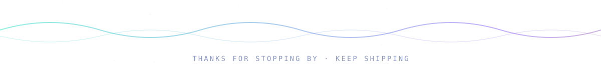

